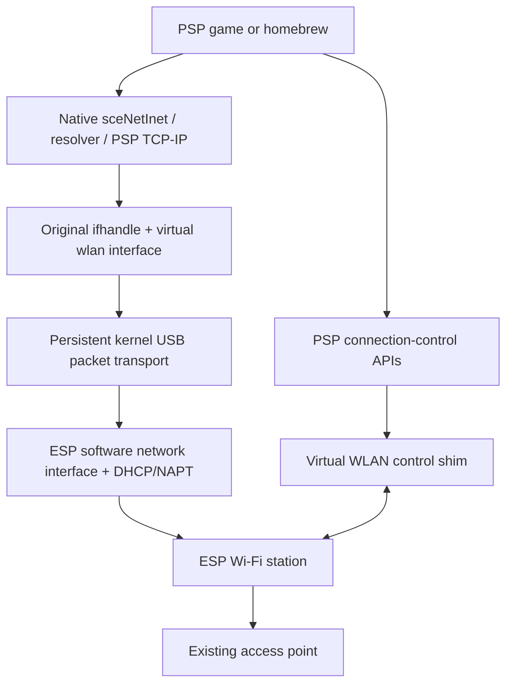

# PSP-E1000 WLAN Stack Integration Plan

Prepared 2026-11-15 from the tested USB/HTML milestones and the supplied decrypted
modules. **Planning and static analysis only:** no firmware, PSP settings, or
running ESP image was changed for this work.

## Implementation Status (2026-11-16)

The first probe passed COMMON/INET load and unload on 6.61 ARK-5, PSP model 10.
The newly supplied upper modules are inventoried in `analysis/module_inventory.json`;
their arrival supersedes the original missing-module observations below. The subsequent v2 native UDP loopback and cleanup test also passed.
Virtual-interface registration, callback dispatch and clean detach/destroy now
passed on PSP with v0.1. The v0.2 local packet lab is built; native ARP/UDP packet
delivery remains pending. See [the registration milestone](../milestones/virtual-interface-registration.md). Scope is now
ARK-5 only, using its existing WPA2 support, with stock setup and browser restoration
as goals. See [current decisions and evidence](STOCK_WLAN_AND_BROWSER.md).

## Recommended Architecture

Build a **virtual WLAN adapter at the PSP interface-driver boundary**, retaining
Sony's interface manager and IP/socket stack where their ABIs permit it. Use USB
as the packet link and ESP Wi-Fi as the upstream connection. Begin with IPv4
infrastructure networking; treat native adhoc compatibility as a separate project
within the roadmap.

The existing HTTPS success establishes ESP networking plus reliable USB delivery.
It does **not** establish native PSP sockets: the ESP currently owns TCP, DNS and
TLS for the downloaded page. The next decisive milestone is an unmodified
`sceNetInet` client reaching a controlled HTTP server through a virtual interface.

Use a private USB subnet: PSP has its own address and virtual MAC; ESP is its
gateway/DHCP service and translates traffic onto its existing station interface.
Choose a subnet that does not overlap the actual AP network. This avoids assuming
an ordinary Wi-Fi station can transparently bridge a second device's MAC, and
keeps PSP TCP state on PSP while ESP performs routing/NAT. Do not run two IP
stacks with the same MAC/IP or steal the station RX callback from ESP's netif.

## What the Supplied Modules Establish

See [static findings](../analysis/NETWORK_MODULE_FINDINGS.md) and the
[machine-readable inventory](../analysis/module_inventory.json).

- `ifhandle.prx` is `sceNet_Service`; `wlan.prx` is `sceWlan_Driver`.
- WLAN imports 16 interface/queue/buffer services from `sceNetIfhandle_driver`.
  The supplied ifhandle exports all of them, including create/attach, enqueue,
  dequeue and buffer operations.
- ifhandle's three imports back into WLAN are drop-policy helpers, supported by
  wrapper call sites and focused disassembly. This is encouraging evidence for
  preserving ifhandle without reproducing the Marvell hardware driver.
- Public WLAN entry points include MAC, switch and power queries. The supplied
  `_lib`/`_driver` exports contain aliases with different NIDs but the same body;
  inventory by **library + NID**, not function name alone.
- Handle allocation, queue links and callbacks are visible, but the packet
  representation, ownership and callback contracts are not fully recovered.
- Upper IP, AP-control and adhoc modules are absent from `modules/`. Their
  dependencies and any E1000 model restrictions are not yet established.

These findings support a candidate insertion point, not a claim that a few NID
hooks already make stock networking work.

## 1. Establish the Runtime ABI and Load Path

Produce a read-only PSP probe that logs firmware/devkit version, CFW version,
model, loaded module/library identities, and return codes for loading the stock
COMMON/INET/APCTL/RESOLVER modules. Log stable import/export identities, not
unvalidated dereferences. Obtain matching decrypted upper modules or runtime
import traces before fixing the hook surface.

Recover and document:

- ifhandle create/attach/detach arguments, interface naming/selection, up/down
  callbacks, ioctl dispatch, TX wakeup and RX notification paths;
- packet/mbuf chains, lengths, headers, allocation/free functions and which side
  owns each object on success, rejection, asynchronous completion and teardown;
- APCTL and netconf scan/connect/disconnect sequences, callback threading,
  DHCP/address delivery and any model/radio-presence gates;
- which native WLAN startup/attach calls touch absent hardware.

**Gate:** a verified ABI/dependency matrix for this firmware and an explanation of
how the stock upper modules can load without a working physical radio. If native
`wlan.prx` cannot load, introduce a RAM-resident compatibility provider for the
required exports; do not silently substitute a differently versioned module.
The three drop-policy helpers are a small starting surface, not the entire shim.

## 2. Turn the USB Demo into a Reusable Packet Transport

Extract transport/power ownership from the file-transfer application. Keep that
application as a regression client. Add independent control, packet and debug
channels, protocol/capability negotiation, link generation IDs, MTU negotiation,
bounded queues, credits/backpressure, cancellation and reconnect state reset.

The 44-byte file chunks and per-chunk ACK are unsuitable as the permanent NIC
path: a 1514-byte Ethernet record needs 35 chunks, so the measured heartbeat RTT
does not represent network-packet latency. Pipeline data and acknowledge credits
or complete packets rather than every tiny fragment. Batch bulk transfers using
multiple **64-byte full-speed USB packets**; increasing transfer size does not
change the endpoint's legal max-packet size. Explicitly test framing at exact
64-byte boundaries and short-packet/ZLP behavior. Bound records to a negotiated
size sufficient for MTU 1500 plus headers; reject oversized/truncated frames.

USB callbacks should signal/enqueue only. Network buffers, memory-stick logging,
and potentially blocking Wi-Fi work belong in worker tasks. Specify cache/DMA
alignment and ownership. Reserve control credits so saturation cannot starve
disconnect/status messages. Serialize all TinyUSB host calls in the existing
host task; Wi-Fi callbacks must not call it directly.

**Gate:** repeated 64/65/512/1500/1514-byte transfers, sustained bidirectional
traffic with measured latency/throughput/queue pressure, and no stale packets,
buffer leaks or hung shutdown after unplug/reconnect. Keep the current HTML and
clean-exit tests passing. Set performance targets from these measurements.

## 3. Register a Virtual Interface with Stock ifhandle

First prove this in a dedicated homebrew test, before game-wide hooks. Reuse the
original ifhandle implementation and its allocator/queue contracts. Build a
small driver that attaches an interface, drains PSP TX queues into USB records,
and reconstructs valid native receive objects for incoming records. Determine
whether the stock dispatcher requires the name `wlan` or can select an alternate
interface; do not assume `usb0` becomes the default route automatically.

Supply a stable locally administered virtual MAC and return it consistently to
network consumers. Replace physical-radio operations with adapter state, never
with writes to unexplained Syscon/GPIO addresses. Intercept native radio attach
before hardware access if the native WLAN module is retained. If a replacement
provider is needed, avoid duplicate active providers for the same library.

Start with the smallest supported IP/link-up configuration. Exercise native
ARP and ICMP against an ESP-side virtual gateway, checking both frame content
and native allocation/free behavior. A function named `Enqueue` is not sufficient
evidence of receive-direction semantics; confirm through callers and a probe.

**Gate:** PSP-generated network packets leave through USB, and injected valid
responses reach Sony's stack without double frees or direct application parsing.

## 4. Route through the ESP and Prove Native PSP Sockets

Add a software USB-facing `esp_netif`/lwIP interface, separate from the existing
Wi-Fi station. Implement address assignment (static for the first probe if
needed, then DHCP), gateway and DNS options, ARP, IPv4 forwarding and NAPT. ESP-IDF
6.0.2 exposes `esp_netif_napt_enable`; its configuration requires
`CONFIG_LWIP_IP_FORWARD` and `CONFIG_LWIP_IPV4_NAPT`. Choose address/MTU/MSS and
buffer limits explicitly; return congestion rather than retaining radio buffers.

Keep the station's normal ESP netif RX handling intact. The installed private
Wi-Fi API permits only one station RX callback, so replacing it as a shortcut
would interfere with the already-working ESP IP path. Use the software interface
and supported netif integration first. Pin any private API dependency to the
tested IDF version if later needed.

Use a controlled LAN server for the acceptance test:

1. Native PSP `sceNetResolver` resolves a name through the configured DNS path.
2. An ordinary `sceNetInet` UDP client exchanges datagrams with an echo service.
3. A native PSP TCP/HTTP client downloads a known file and matches its length and
   hash. The ESP must forward packets, not generate the HTTP request itself.
4. Exercise simultaneous sockets, nonblocking/select behavior, EOF, disconnect,
   DHCP renewal and resource cleanup under load.

**Gate:** a PSP application using stock network APIs works without transport-aware
changes. Keep modern HTTPS out of this gate: legacy PSP TLS/certificates may fail
independently of a correct network adapter. Preserve the current explicit ESP
HTTPS/file-offload feature rather than presenting it as native PSP TLS support.

## 5. Match Native Connection Control

Implement the verified `_lib`/`_driver` imports and ioctls used by APCTL, with real
scan results/status transitions, asynchronous completion, MAC/RSSI, disconnect,
timeout and power/switch semantics. Reflect actual USB/Wi-Fi state; returning
“connected” from a stub without a working interface is not an acceptance result.

Initially retain adapter-managed Wi-Fi credentials on ESP and expose a documented
single preconfigured adapter connection to the test homebrew. Native profile/UI
integration is a separate gate: map only representable security capabilities,
report unsupported modes, and do not advertise WPA3 as WEP or send credentials
to logs. Recover profile handling before promising stock scan/UI compatibility.

**Gate:** the stock APCTL connection sequence reaches a usable IP state; profile
selection, cancellation, reconnect and error callbacks agree with packet-path
state. Then test the native network-configuration dialog.

## 6. Package as a Game-Compatible CFW Plugin

Move lifetime management into a kernel service and CFW module-start/import-hook
integration. It must initialize for GAME networking without the demo EBOOT,
preserve game-specific net init/term behavior, and release resources on unload.
Handle VSH/GAME transitions, USB conflict detection, suspend/resume, adapter loss
and ESP reboot. Keep HOME/XMB exit outside the old worker/self-join cycle.

Use file fingerprints, module/library versions, expected relocated instruction
patterns and NID resolution to refuse unknown builds. All offsets in the static
inventory are image-relative; never write them directly as runtime addresses.
Respect GP/K1, calling conventions and cache synchronization when redirecting
calls. Treat E1000 model checks surgically; do not globally impersonate another
PSP model. Deploy reversibly from the memory stick with a disable/bypass path;
do not replace `flash0:` files for the initial implementation.

**Gate:** first a homebrew infrastructure client, then one selected infrastructure
game, then a small compatibility matrix with repeatable start/connect/quit tests.
USB debug/RemoteJoyLite conflicts must be explicit rather than silently stealing
their driver. Powering ESP from PSP pads remains a separate electrical milestone;
3.3 V observed unloaded does not establish its Wi-Fi current budget.

## 7. Add Adhoc as an Independent Compatibility Track

Stock adhoc games require more than infrastructure IP sockets: discovery, Sony
control traffic, peer/group state, matching and game-mode behavior can traverse
the same lower boundary. Inventory the missing adhoc modules and packet formats
before choosing a transport. Do not assume ESP station mode or raw-injection APIs
provide PSP-compatible 802.11 IBSS automatically.

A controlled UDP tunnel between ESP-backed PSPs is a plausible first backend;
interoperation with unmodified Wi-Fi PSPs or emulator tunneling is a separate
acceptance target. Identify broadcast/multicast handling, timing, channel/group
semantics, NAT traversal and peer hardware requirements before promising it.

**Gate:** two actual compatible peers discover, join, exchange data and play a
selected title; infrastructure success alone must not be reported as adhoc support.

## Decision Gates and Fallbacks

| Finding | Response |
| --- | --- |
| Native upper modules load and ifhandle callback ABI is usable | Continue the virtual-interface/NAPT architecture. |
| Native WLAN startup touches absent hardware | Divert attach or supply the required compatible exports in RAM before initialization. |
| ifhandle/IP coupling cannot be reproduced safely in the prototype | Use a clearly labeled socket-offload shim for selected applications while continuing ABI work; it does not prove native stack integration. |
| Native TCP works but modern HTTPS fails | Diagnose TLS separately; do not undo the packet adapter or bypass certificate checks. |
| Infrastructure works but adhoc does not | Keep infrastructure usable and pursue the separate adhoc control/data backend. |

## Ownership and Immediate Next Deliverable

Agents perform static analysis, implementation, native tests and ESP flashing/
UART tests. **The user performs every PSP test** after receiving built artifacts
and exact steps; no new logic-analyzer captures are needed for the first phases.

The next implementation deliverable should be **a read-only network-module/ABI
probe plus the matching upper-module inventory**, not a broad WLAN patch. Then
build the virtual-interface ARP/ICMP proof and packet-transport upgrade before
attempting a stock game.

Primary references: the supplied modules and generated findings; installed
PSPSDK `systemctrl.h`/network headers; [PSP NID database](https://github.com/pspdev/psp-ghidra-scripts/blob/master/ppsspp_niddb.xml);
[ESP-IDF network-interface API](https://docs.espressif.com/projects/esp-idf/en/v6.0.2/esp32s3/api-reference/network/esp_netif_programming.html).

Current checkpoint: native ARP/eight-UDP packets over USB passed with PSPv0.6/
ESPv8, including clean teardown. PSPv0.7/ESPv9 now implements forwarding/NAPT,
a RAM default route and native TCP/HTTP memory-stick download; this hardware
gate is pending. See milestones/native-internet-routing.md. Stock APCTL/profile
and browser integration follow verified native internet delivery.
